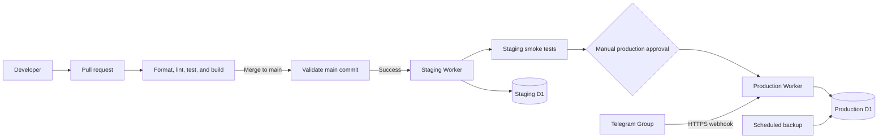

# SettleBot

A production-minded serverless application built to demonstrate cloud architecture, automated delivery, secure operations, and cost-conscious system design.

> **Status:** Domain core complete; Phase 2 persistence locally verified, remote CI pending
>
> **Stack:** Rust, Cloudflare Workers, Cloudflare D1
>
> **Target cost:** S$0/month within Cloudflare's free tier

The [implementation plan](agent_docs/implementation-plan.md) defines ordered completion gates and records verification evidence. Phases 0 and 1 are complete. Phase 2 persistence passes local validation and awaits a successful remote CI run before completion. The current workflow validates pull requests and `main`; it does not deploy.

## Overview

SettleBot records zero-sum win/loss sessions for a private Telegram group. It tracks cumulative and game-specific results while preserving exact session history and auditable corrections.

The ledger is intentionally small in scope so the project can focus on the complete cloud application lifecycle: architecture, provisioning, testing, deployment, monitoring, security, backup, and recovery.

## Cloud and DevOps goals

### Serverless architecture

- Event-driven processing through Telegram webhooks
- Rust compiled to WebAssembly for Cloudflare Workers, using the `workers-rs` ecosystem
- Cloudflare D1 for persistence
- Services that scale to zero instead of an always-running server
- Architecture sized for a low-traffic workload and the free tier

### Planned delivery workflow

- GitHub-based source control and change review
- Pull requests run formatting, Clippy linting, tests, and a production Worker build without deploying
- Merges to `main` run validation, then automatically deploy the successful commit to staging
- Staging smoke tests must pass before the same commit can be promoted
- Production deployment requires a manual approval gate
- Versioned, backward-compatible D1 migrations run as a separate controlled step

### Environment and secret management

- Separate local, staging, and production environments
- Environment-specific Worker and D1 configuration
- Encrypted Cloudflare secrets for credentials and production identifiers
- No secrets or production data committed to the repository

### Operations and recovery

- Structured logs and application health checks
- Idempotent webhook processing and transactional writes
- Scheduled backups and portable data exports
- Deployment, rollback, and recovery runbooks
- Documented cost limits and migration options

## Planned product capabilities

- Record sessions involving any subset of roster players
- Let administrators add permanent roster players and games, with Mahjong and Poker as initial games
- Include one-time guests only in their selected sessions
- Require every session to total exactly `S$0.00`
- Track overall and game-specific standings
- Show player and session histories using the session's Asia/Singapore calendar date, separately from its UTC creation timestamp
- Correct or void sessions without deleting audit history
- Restrict changes to administrators
- Export the ledger as CSV or JSON

One-time guests are excluded from leaderboards but remain visible in the relevant session details.

## Implemented domain core

The pure [domain module](src/domain/mod.rs) defines signed integer cents, roster players and status, games, session-scoped guests, participant selections, and draft/confirmed sessions. Confirmation requires one game, at least two distinct participants, exactly one amount for every selected identity, and a checked zero-cent total. Guest amounts count in that total; guests remain a separate type from roster players. Confirmed records expose no mutation API.

`occurred_on` is an explicitly selected Asia/Singapore calendar date in `YYYY-MM-DD` form, with valid years 0001–9999. `created_at` is a separately injected UTC instant. The domain reads no clock and never derives the played date from the creation instant.

Identifiers are case-sensitive, nonempty ASCII letters, digits, hyphens, or underscores. Display names are trimmed, must be nonempty, and reject embedded control characters; duplicate display names are allowed because identity controls uniqueness. A guest identity includes its owning session.

The [pure tests](src/domain/tests/mod.rs) cover validation, selection and amount completeness, roster/guest separation, numeric boundaries and overflow, SGD formatting, and creation around Singapore midnight. Normal roster pickers, leaderboards, authorization, and Telegram workflows remain planned.

## Implemented persistence

The [persistence module](src/persistence/mod.rs) provides injected repository contracts and use cases for roster players, games, persistent drafts, confirmed sessions with entries, and successful processed updates. Its D1 adapter reconstructs validated domain values on reads. [Versioned migrations](migrations/) create the schema and seed only Mahjong and Poker. Display names may repeat; case-sensitive stable IDs control uniqueness.

Drafts retain their numeric owner, selected game and date, ordered roster/guest participants, partial integer-cent amounts, revision, and open/consumed state. Confirmation validates the complete zero-sum session and commits its entries, draft consumption, and idempotent result in one D1 batch. Replaying the same update returns its original result; a different update against a consumed draft is rejected. The [persistence notes](agent_docs/persistence.md) describe the transaction and local test boundary.

This is a persistence foundation without public write routes. The Worker still exposes only its health check; Telegram authorization and workflows start in Phase 3.

## Target architecture



The planned delivery flow keeps pull requests deployment-free, deploys successful `main` builds to an isolated staging environment, and requires staging smoke tests plus manual approval before production promotion. Production will use a stable Worker URL for the Telegram webhook, so routine releases update the Worker behind that endpoint rather than reconfiguring the bot.

Staging and production will use separate Workers, D1 databases, secrets, and Telegram test contexts. Production promotion must deploy the same verified commit tested in staging. Worker rollback does not roll back D1, so schema changes require separately controlled, backward-compatible migrations and a tested recovery path.

## Development

### Prerequisites

- Rust 1.99.0 with the `wasm32-unknown-unknown` target, Rustfmt, and Clippy
- Node.js 24 and pnpm 11.25.0
- On Windows, Microsoft C++ Build Tools with the Windows SDK

Install the pinned JavaScript tooling:

```shell
pnpm install --frozen-lockfile
```

Run the local Worker:

```shell
pnpm dev
```

Apply migrations to the local development database before persistence development:

```shell
pnpm db:migrate:local
```

The `local` Wrangler environment contains only a local placeholder database identity. No staging or production resources are configured. Remote migrations require a separately configured environment and explicit authorization.

Run the same validation stages used by CI:

```shell
cargo fmt --all -- --check
cargo clippy --locked --all-targets -- -D warnings
cargo test --locked --all-targets
pnpm test:d1
pnpm build
```

The current Worker exposes `GET /health` as a minimal platform smoke check. Native [request tests](src/tests.rs) exercise the same routing and response code as the Worker, verifying HTTP 200, JSON content type, the exact `{"status":"ok"}` body, and 404s for unknown paths and unsupported health methods. `pnpm build` compiles the release Worker and performs a deployment dry run.

`pnpm test:d1` builds a separate feature-gated Rust test module and runs 13 integration cases against Wrangler's actual local D1/workerd runtime. It starts from an empty ephemeral database, applies the migrations, and checks resumption, ownership, identity uniqueness, guest accounting, concurrent updates and draft edits, rollback, replay/retry, malformed values, and full `i64` cent precision. The small JavaScript bridge exists only in the test harness; the production backend stays Rust. The pinned workerd supports dates through `2026-10-13`, so only the test configuration uses that date; the production configuration retains `2026-10-14`.

Telegram credentials and user-facing application workflows will be added in later phases.

## Planned operational controls

- SGD amounts displayed in dollars and cents, and stored internally as integer cents for accuracy
- Transactional session writes
- Duplicate webhook protection
- Exact numeric group allowlisting and an explicit numeric SettleBot administrator allowlist
- Per-user rate limiting
- Indexed and paginated queries
- Audited corrections
- Encrypted secrets
- Backup and recovery procedures

## Planned environments

| Environment | Purpose | Deployment policy |
|---|---|---|
| Local | Development and testing | Manual local execution |
| Staging | Telegram testing with dummy data | Automatic after successful `main` CI |
| Production | Private group ledger | Manual promotion after staging verification |

## Privacy

The repository will not contain Telegram tokens, production IDs, real roster names, ledger records, or Cloudflare credentials. Administrators will create the private roster through the authenticated Telegram workflow after deployment.
