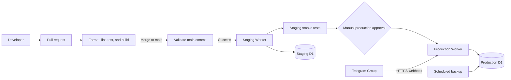

# SettleBot

A production-minded serverless application built to demonstrate cloud architecture, automated delivery, secure operations, and cost-conscious system design.

> **Status:** Phases 0–6 validated; Phase 7 in preparation; not deployed
>
> **Stack:** Rust, Cloudflare Workers, Cloudflare D1
>
> **Target cost:** S$0/month within Cloudflare's free tier

The [implementation plan](agent_docs/implementation-plan.md) defines ordered completion gates and records verification evidence. Phases 0–6 are on `main`; Phase 6 commit `7c91f1f` passed [CI run 42460091640](https://github.com/clllllllllllllll/SettleBot/actions/runs/42460091640). Phase 7 configuration and workflows are in preparation, with deployment disabled in source. The Telegram workflow has not been exercised against live Telegram or remote D1. CI validates pull requests and `main`; it does not currently deploy.

## Overview

SettleBot records zero-sum win/loss sessions for a private Telegram group. It tracks cumulative and game-specific results while preserving exact session history and auditable corrections.

The ledger is intentionally small in scope so the project can focus on the complete cloud application lifecycle: architecture, provisioning, testing, deployment, monitoring, security, backup, and recovery.

## Cloud and DevOps goals

### Serverless architecture

- Event-driven processing through Telegram webhooks
- Rust compiled to WebAssembly for Cloudflare Workers, using the `workers-rs` ecosystem
- Cloudflare D1 for persistence
- Services that scale to zero instead of an always-running server
- Architecture sized for a low-traffic workload and the free tier

### Planned delivery workflow

- GitHub-based source control and change review
- Pull requests run formatting, Clippy linting, tests, and a production Worker build without deploying
- Merges to `main` run validation, then automatically deploy the successful commit to staging
- Staging smoke tests must pass before the same commit can be promoted
- Production deployment requires a manual approval gate
- Versioned, backward-compatible D1 migrations run as a separate controlled step

### Environment and secret management

- Separate local, staging, and production environments
- Environment-specific Worker and D1 configuration
- Encrypted Cloudflare secrets for credentials and production identifiers
- No secrets or production data committed to the repository

### Operations and recovery

- Structured logs and application health checks
- Idempotent webhook processing and transactional writes
- Scheduled backups and portable data exports
- Deployment, rollback, and recovery runbooks
- Documented cost limits and migration options

## Product scope

- Record sessions involving any subset of roster players
- Let administrators add permanent roster players and games, with Mahjong and Poker as initial games
- Include one-time guests only in their selected sessions
- Require every session to total exactly `S$0.00`
- Track overall and game-specific standings
- Show player and session histories using the session's Asia/Singapore calendar date, separately from its UTC creation timestamp
- Correct or void sessions without deleting audit history
- Restrict changes to administrators
- Export the ledger as CSV or JSON

One-time guests are excluded from leaderboards but remain visible in the relevant session details.

Session entry, administrator roster/game creation, roster reporting, session history, audited amount corrections and voids, portable JSON export, and local recovery verification are implemented. Remote backup operations and delivery remain planned.

## Implemented domain core

The pure [domain module](src/domain/mod.rs) defines signed integer cents, roster players and status, games, session-scoped guests, participant selections, and draft/confirmed sessions. Confirmation requires one game, at least two distinct participants, exactly one amount for every selected identity, and a checked zero-cent total. Guest amounts count in that total; guests remain a separate type from roster players. Confirmed records expose no mutation API.

`occurred_on` is an explicitly selected Asia/Singapore calendar date in `YYYY-MM-DD` form, with valid years 0001–9999. `created_at` is a separately injected UTC instant. The domain reads no clock and never derives the played date from the creation instant.

Identifiers are case-sensitive, nonempty ASCII letters, digits, hyphens, or underscores. Display names are trimmed, limited to 64 characters, must be nonempty, and reject embedded control characters; duplicate display names are allowed because identity controls uniqueness. Sessions accept at most 16 participants. A guest identity includes its owning session.

The [pure tests](src/domain/tests/mod.rs) cover validation, selection and amount completeness, roster/guest separation, numeric boundaries and overflow, SGD formatting, and creation around Singapore midnight. Telegram participant pickers include active roster players only; reporting includes roster players only.

## Implemented persistence

The [persistence module](src/persistence/mod.rs) provides injected repository contracts and use cases for roster players, games, persistent drafts, confirmed sessions with entries, and successful processed updates. Its D1 adapter reconstructs validated domain values on reads. [Versioned migrations](migrations/) create the schema and seed only Mahjong and Poker. Display names may repeat; case-sensitive stable IDs control uniqueness.

Drafts retain their numeric owner, selected game and date, ordered roster/guest participants, partial integer-cent amounts, revision, and open/consumed state. Confirmation validates the complete zero-sum session and commits its entries, draft consumption, and idempotent result in one D1 batch. Replaying the same update returns its original result; a different update against a consumed draft is rejected. The [persistence notes](agent_docs/persistence.md) describe the transaction and local test boundary.

The authorized Telegram webhook now uses this foundation. Incomplete guided selections live in durable workflow records; confirmation creates and consumes the validated ledger draft in the same atomic batch as the session and both replay records.

## Implemented Telegram workflow

`POST /telegram/webhook` checks the webhook secret, configured numeric group ID, and explicit numeric administrator allowlist before application storage access. Private chats, other groups, channels, anonymous/bot senders, business-account messages, and unverifiable identities are rejected. Every callback and text step checks draft ownership, group, revision, and workflow stage.

Administrators use `/player Name` and `/game Name` to create permanent catalog entries, then `/session` to choose a game, enter the Asia/Singapore played date, select roster players or add session-scoped guests, enter signed SGD amounts, review, and confirm a zero-cent total. `/resume SESSION_ID` restores the current prompt. Every successful mutation has an atomic durable reply keyed by Telegram update ID. See [Telegram configuration and commands](agent_docs/telegram.md).

## Implemented resilience controls

Authorized ordinary group text is acknowledged without admission, storage, or a reply, including
while a draft is open. Slash commands and callbacks use the normal rate protection; unknown
slash commands retain invalid-command guidance. Keep Telegram bot privacy mode enabled where
practical, but input classification also protects groups where ordinary messages reach the bot.

The webhook bounds request bodies, command text, callback data, display names, catalog creation/snapshots, participant selections, and report pages. Catalog creation stops at 24 active players or games, with D1 guards preserving the limit across concurrent requests. Report pages contain 10 rows, with validated limits of 50 rows and page 10,000. Authorized administrators are limited to 20 new update IDs per rolling minute; duplicate delivery of an admitted update remains replayable without consuming another slot, including after its original rate window expires.

Outbound Telegram work has a five-second deadline. Telegram sends, workflow changes, and ledger writes are never retried inline because an ambiguous response could duplicate effects. Only idempotent rate-limit admission may retry, with at most two attempts. Static structured failure events contain a category and retryability only—never tokens, secrets, IDs, roster details, inputs, or amounts. See [Telegram resilience details](agent_docs/telegram.md#resilience-and-failure-handling).

Telegram delivery classifies network failures, timeouts, rate limits (including `retry_after`),
server failures, ambiguous responses, and configuration/access failures as HTTP 503. A confirmed
permanent message rejection is logged with static redacted fields and acknowledged with HTTP 200,
including callback acknowledgement. The ledger action may already be committed and its notification
is lost. Sends have no inline retries; transient redelivery replays the committed receipt.
Classification follows the [Bot API response contract](https://core.telegram.org/bots/api#making-requests)
and [response parameters](https://core.telegram.org/bots/api#responseparameters); unrecognized 4xx
responses remain ambiguous rather than discarding a potentially deliverable notification.

## Implemented reporting

Report totals remain exact signed `i128` cents through aggregation, sorting, and SGD rendering,
including totals beyond an individual entry's `i64` range. Test RPC totals cross JavaScript as
decimal strings. Stored entry ranges and valid played-date years (0001–9999) are unchanged.

Aggregate reports use at most 37 contribution queries of 100 rows. Together with the initial
snapshot batch and two reserved admission attempts, this caps D1 calls at 40, leaving ten below
the [Free invocation limit](https://developers.cloudflare.com/d1/platform/limits/). Completion
requires a short final batch: at most 3,699 matching roster contributions are supported per
overall/per-game report, or per player for `/stats`. Larger histories return a clear capacity
reply with HTTP 200 and no partial totals; `/history` and `/details` remain available. This is
a controlled limit, with no recent-history substitution or unlimited-history claim.

Local regression tests exercise the production overall, per-game, and player aggregation at
captured session/audit boundaries across multiple batches, later appends, corrections, and voids.
Snapshot test hooks are compiled only with the `d1-test` feature.

Authorized administrators can view overall and per-game roster leaderboards, a roster player's dated session results, chronological session history, and full details for one session. Overall and per-game rankings include permanent roster players, including zero-result players, and exclude one-time guests. Player and ordinary session histories also omit guest data; the relevant session's `/details` response is the only report that shows its guest identity and amount.

Report queries use validated pages of 10 rows, cap page sizes at 50 and page numbers at 10,000, and sort with stable identity tie-breakers. Rankings order by total, display name, and player ID; histories order by the exact Asia/Singapore played date and session ID. Exact contribution totals are accumulated in checked widened integers from deterministic 100-row D1 batches. Captured session-row and audit-row boundaries keep each multi-batch report on one logical snapshot while bounding Worker memory; total scan work and latency still grow with matching ledger history. Reporting is read-only and creates no workflow receipt or ledger write. See [Telegram reporting commands](agent_docs/telegram.md#reporting-commands) and [persistence reporting rules](agent_docs/persistence.md#reporting-queries).

## Implemented audit and recovery

Read `/details SESSION_ID` for its current revision (0 for the original). Corrections require
`/correct SESSION_ID REVISION +5.00 -5.00 | reason`; voids require
`/void SESSION_ID REVISION | reason`. Stale commands direct the administrator to reread details.
Void is terminal for both commands; exact replay of a previously successful update still returns
its original receipt. Revision and prior state are checked inside the atomic D1 mutation, including
voids with no replacement entries. Receipt/storage failure rolls back the whole audit transaction.

Authorized administrators can append amount corrections or voids with required reasons. The original session and entries are never updated or deleted. Current reports resolve the latest audit event; voided sessions leave current aggregates and histories, while details retain the last non-void values and traverse complete actor, timestamp, reason, and revision lineage three events at a time with a revision cursor that has no page-number ceiling. Effective entries, audit metadata, and current state are read in one D1 batch so each detail response uses one snapshot. Every detail reply is checked against Telegram's 4,096-character limit. Report snapshots capture both session and audit-event boundaries so later corrections cannot enter an in-progress multi-batch report.

The separately authenticated `GET /admin/export` production route and operator CLI produce deterministic, cursor-based `settlebot-ledger-v1` JSON chunks containing catalogs, original records, and every audit revision. The cursor freezes player, game, session, and audit row boundaries, so later appends cannot enter continuation chunks. Catalog cursor positions export all historical inactive players in bounded 24-row chunks before session data; there is no total-roster ceiling. Chunks and D1 work are bounded, the cursor has no report-page ceiling, and export data is never sent through Telegram. Local recovery tests restore that export into a second isolated D1 and compare record counts, current totals, and lineage. The authoritative remote D1 backup, isolated restore, and migration procedure is documented in [backup and recovery](agent_docs/recovery.md); no remote backup or restore has been performed.

## Target architecture



The planned delivery flow keeps pull requests deployment-free, deploys successful `main` builds to an isolated staging environment, and requires staging smoke tests plus manual approval before production promotion. Production will use a stable Worker URL for the Telegram webhook, so routine releases update the Worker behind that endpoint rather than reconfiguring the bot.

Staging and production will use separate Workers, D1 databases, secrets, and Telegram test contexts. Production promotion must deploy the same verified commit tested in staging. Worker rollback does not roll back D1, so schema changes require separately controlled, backward-compatible migrations and a tested recovery path.

## Development

### Prerequisites

- Rust 1.99.0 with the `wasm32-unknown-unknown` target, Rustfmt, and Clippy
- Node.js 24 and pnpm 11.25.0
- On Windows, Microsoft C++ Build Tools with the Windows SDK

Install the pinned JavaScript tooling:

```shell
pnpm install --frozen-lockfile
```

Run the local Worker:

```shell
pnpm dev
```

Apply migrations to the local development database before persistence development:

```shell
pnpm db:migrate:local
```

The `local` Wrangler environment contains only a local placeholder database identity. Remote environment configuration is generated from private IDs using the prepared [delivery tooling](agent_docs/deployment.md); no staging or production resources exist yet. Remote migrations require separate explicit authorization.

Run the same validation stages used by CI:

```shell
cargo fmt --all -- --check
cargo clippy --locked --all-targets -- -D warnings
cargo test --locked --all-targets
pnpm test:d1
pnpm test:delivery
pnpm build
```

The current Worker exposes `GET /health` as a minimal platform smoke check. Native [request tests](src/tests.rs) verify HTTP 200, JSON content type, the exact `{"status":"ok"}` body, and 404s for unknown paths and unsupported health methods. Health responses use `no-store`; deployments configured with `RELEASE_SHA` also identify the commit in `X-SettleBot-Commit`. `pnpm build` compiles the release Worker and performs a deployment dry run.

`pnpm test:d1` builds feature-gated Rust test modules and runs 37 integration cases against Wrangler's actual local D1/workerd runtime. It starts from empty ephemeral databases, applies all five migrations, and checks persistence, Telegram authorization, guided flows, multi-batch reporting, correction/void lineage, audit rollback and snapshot consistency, portable export and isolated restore, rejected and oversized requests, throttling, concurrency, rollback, timeout/delivery replay, and full `i64` cent precision. Outbound Telegram sends use an injected test transport. The small JavaScript bridge exists only in the test harness; the production backend stays Rust. The pinned workerd supports dates through `2026-10-13`, so only the test configuration uses that date; the production configuration retains `2026-10-14`.

For local configuration, copy [.dev.vars.example](.dev.vars.example) to the ignored `.dev.vars` file and supply environment-specific values. The example is fake and cannot contact a real bot. Production and staging bindings, secrets, webhook configuration, and deployments remain separately authorized work.

## Operational controls

- SGD amounts displayed in dollars and cents, and stored internally as integer cents for accuracy
- Transactional session writes
- Duplicate webhook protection
- Exact numeric group allowlisting and an explicit numeric SettleBot administrator allowlist
- Bounded webhook inputs, participants, catalogs, and reporting pages
- Per-administrator rolling rate limits with duplicate-update admission
- Five-second Telegram deadlines and retries restricted to idempotent rate admission
- Static structured error logs without request or ledger data
- Credentials and authorization configuration read from Worker secret bindings

Phase 6 passed local and remote CI validation; remote backup, restore, and live Telegram evidence do not exist. Phase 7 has prepared artifact promotion, environment configuration, read-only smoke checks, and an [operations runbook](agent_docs/deployment.md), with release execution disabled. Secret provisioning, remote environments, deployment/smoke evidence, approval configuration, alerting, and rollback verification remain outstanding. The repository is not production-ready or deployed.

## Planned environments

| Environment | Purpose | Deployment policy |
|---|---|---|
| Local | Development and testing | Manual local execution |
| Staging | Telegram testing with dummy data | Automatic after successful `main` CI |
| Production | Private group ledger | Manual promotion after staging verification |

## Privacy

The repository will not contain Telegram tokens, production IDs, real roster names, ledger records, or Cloudflare credentials. Administrators will create the private roster through the authenticated Telegram workflow after deployment.
