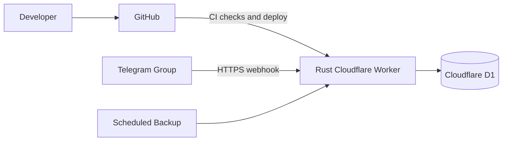

# SettleBot

A production-minded serverless application built to demonstrate cloud architecture, automated delivery, secure operations, and cost-conscious system design.

> **Status:** Foundation scaffolded; product features not yet implemented
>
> **Stack:** Rust, Cloudflare Workers, Cloudflare D1
>
> **Target cost:** S$0/month within Cloudflare's free tier

## Overview

SettleBot records zero-sum win/loss sessions for a private Telegram group. It tracks cumulative and game-specific results while preserving exact session history and auditable corrections.

The ledger is intentionally small in scope so the project can focus on the complete cloud application lifecycle: architecture, provisioning, testing, deployment, monitoring, security, backup, and recovery.

## Cloud and DevOps goals

### Serverless architecture

- Event-driven processing through Telegram webhooks
- Rust compiled to WebAssembly for Cloudflare Workers, using the `workers-rs` ecosystem
- Cloudflare D1 for persistence
- Services that scale to zero instead of an always-running server
- Architecture sized for a low-traffic workload and the free tier

### Continuous delivery

- GitHub-based source control and change review
- Automated Rust formatting, Clippy linting, compilation, and testing
- Deployment gates that prevent failed builds from reaching production
- Versioned database migrations and controlled releases

### Environment and secret management

- Separate local, staging, and production environments
- Environment-specific Worker and D1 configuration
- Encrypted Cloudflare secrets for credentials and production identifiers
- No secrets or production data committed to the repository

### Operations and recovery

- Structured logs and application health checks
- Idempotent webhook processing and transactional writes
- Scheduled backups and portable data exports
- Deployment, rollback, and recovery runbooks
- Documented cost limits and migration options

## Planned product capabilities

- Record sessions involving any subset of roster players
- Add one-time guests or permanent roster players
- Require every session to total exactly `S$0.00`
- Track overall and game-specific standings
- Show dated player and session histories
- Correct or void sessions without deleting audit history
- Restrict changes to administrators
- Export the ledger as CSV or JSON

One-time guests are excluded from leaderboards but remain visible in the relevant session details.

## Target architecture



The intended delivery flow runs automated checks before deployment. Telegram will send updates to a secured Cloudflare Worker, which will validate permissions, apply the ledger rules, and store transactional records in D1.

## Development

### Prerequisites

- Rust 1.99.0 with the `wasm32-unknown-unknown` target, Rustfmt, and Clippy
- Node.js 24 and pnpm 11.25.0
- On Windows, Microsoft C++ Build Tools with the Windows SDK

Install the pinned JavaScript tooling:

```shell
pnpm install --frozen-lockfile
```

Run the local Worker:

```shell
pnpm dev
```

Run the same validation stages used by CI:

```shell
cargo fmt --all -- --check
cargo clippy --locked --all-targets -- -D warnings
cargo test --locked --all-targets
pnpm build
```

The current Worker exposes `GET /health` as a minimal platform smoke check. D1 bindings, migrations, Telegram credentials, and application features will be added in later changes.

## Planned operational controls

- SGD amounts displayed in dollars and cents, and stored internally as integer cents for accuracy
- Transactional session writes
- Duplicate webhook protection
- Group and administrator restrictions
- Per-user rate limiting
- Indexed and paginated queries
- Audited corrections
- Encrypted secrets
- Backup and recovery procedures

## Planned environments

| Environment | Purpose |
|---|---|
| Local | Development and testing |
| Staging | Telegram testing with dummy data |
| Production | Private group ledger |

## Privacy

The repository will not contain Telegram tokens, production IDs, real ledger records, or Cloudflare credentials.
